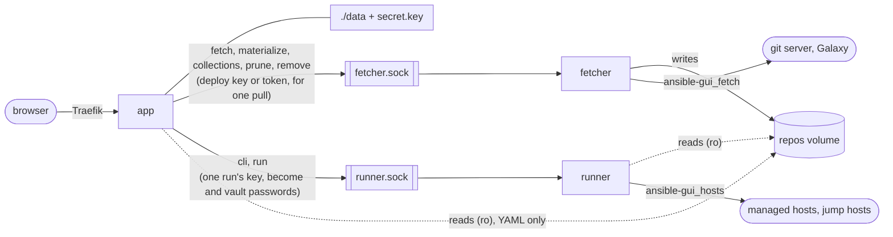

# Runner split

Code from a repository (playbooks, inventory plugins, `ansible.cfg`, collections) never runs in the process
that holds the secrets. Three containers start from one image:

- **app** (uid 10001) holds every secret: the master key, the credential database, the OIDC and SMTP secrets.
  It never starts git or Ansible. It reads commit directories only as YAML, with the safe loader, to list
  playbooks and show where a variable is set, and never through a link that leads out of the repositories
  (`src/ansible_gui/repofiles.py`).
- **fetcher** (uid 10002) pulls the repositories and installs their collections. It is the only container that
  can write the repos volume, and it never runs what it writes.
- **runner** (uid 10003) runs Ansible: the inventory, host previews, the settings report and runs. It mounts the
  repos volume read-only and holds one run's credentials only while that run lasts. Each time its jobs are done
  it clears out whatever they left in its container.

All three run non-root with a read-only root, every capability dropped and `no-new-privileges`. They are fixed
services in `deploy/docker-compose.yml`. Nothing starts a container per job, and nothing needs the Docker socket.

Built on `main` in `12dc2c3`..`ad36e96`, 20–21 Nov 2026. This page replaces the design artifact that was used
while building it.



## Why

Before the split, everything ran as the web app's own user. On 20 Nov 2026, against the `security-review`
image with the compose file's hardening and dummy secrets, a process running as uid 10001 read
`ANSIBLE_GUI_SECRET_KEY` and `ANSIBLE_GUI_SMTP_PASSWORD` from `/proc/1/environ` and could write
`/data/ansible-gui.db`. Removing the variables from the app's environment stops children inheriting them. It
does not hide them from a process with the same uid. So write access to a repository was admin access to the
server.

What a hostile playbook gets:

| Target | Before | After |
|---|---|---|
| Master key | Reads the key file | Not mounted in its container |
| Credentials the run wasn't given | Decrypts all of them | Never sees them |
| OIDC client secret, SMTP password | Reads `/proc/1/environ` | Not in its container |
| Signing in as an admin | Signs a session cookie with the key | No key to sign with |
| Schedules, run history, logs | Writes the database and log files | Can only send its own run's output |
| Repositories and collections later runs use | Writes them | Read-only mount |
| Known hosts | Writes the file | A key for a host that has none yet, as a first connection gives |
| Credentials of later runs | All of them, through the key | Only of a job that runs while it does. What it leaves in the runner is cleared out before the next |
| This run's key and become password | Has them | Has them |
| The hosts that account reaches | Reaches them | Reaches them |

`deploy/smoke-test.sh` checks the "After" column. A hostile playbook in the runner must report
`KEY=closed DB=closed ENV=closed REPOS=closed SOCKET=closed WORKER=closed`, the runner's own uid must be refused
on the socket, and the process and files the playbook leaves must be gone once its run is over, with the runner
not restarted and the next run working.

## One directory per commit

```
/repos
  3/                          repository 3
    git/                      bare clone, full history of the branch, no working files
    commits/
      9f2c1ab04d11…e07a/      one commit, whole, never written again; no .git inside
      5d0e77c1b2a9…41fc/      an earlier one, until it is pruned
  collections/
    c41d9a…77b2/              SHA-256 of a requirements file
      ansible_collections/…
```

- **Named by content.** A commit directory is named by the full commit hash, and a collections directory by the
  SHA-256 of its requirements file. The same name always means the same files.
- **Written once.** Each one is built under a temporary name and renamed into place when complete. A directory
  that exists is whole, and has no write permission left on it or anything in it. The fetcher writes every
  repository as one user, so the modes are what keeps a program it runs for one repository out of another's.
- **A run executes one commit from its first task to its last.** A pull never changes files under a running
  play, so the commit on the run page is exactly what ran.
- **The app knows which commit is current.** It records the commit each pull returns. Nothing in the volume
  points at "current".
- **Pruning is a job.** The app sends the fetcher the directories still in use: each repository's current commit
  and the commits of waiting or running runs. The fetcher removes the rest.
- **A local checkout** (`ANSIBLE_GUI_PROJECT_DIR`) stays as it is. It is someone's working directory and has no
  commits to name.
- **If the repos volume is recreated** while `data/` survives, the app writes each current commit out again at
  startup (`Workspace.restore`).

## Running a run again

Each run records the full playbook commit, the full inventory commit and the collections it used.

- **Run again** pulls and runs the latest commits. Schedules always do this.
- **Run the same commits** runs the earlier run's commits. A pruned directory is written out again from the bare
  clone first.

"Run again" opens the launcher on the latest commits. When a repository has moved since the earlier run, the
launcher says so and offers the earlier run's commits, with a link back to the latest. If a commit is gone
upstream (force-pushed away from the bare clone too), the launcher says so and runs the latest. The host check
before a run reads the same commits the run will use.

**Collections are the soft spot.** A collections directory is named after the requirements file, not after what
Galaxy returned. While it is on disk, a re-run gets exactly the same modules. If it was pruned and the
requirements file doesn't pin exact versions, reinstalling can bring newer collections. The run page says when
that happened.

## Jobs and the socket

Each worker listens on a Unix socket in a tmpfs volume it shares only with the app. It accepts a connection only
from uid 10001, which the kernel reports for the other end of the socket (`SO_PEERCRED`, or `LOCAL_PEERCRED`
on macOS). There is no TCP listener. The runner can't reach the fetcher's socket.

One connection per job, one JSON object per line (`src/ansible_gui/worker/socket.py`):

```
app    → {"kind": "run", "job": {...}}
worker → {"message": {"scratch": "/tmp/agui-…"}}
worker → {"message": {"event": {...ansible-runner's event, unchanged...}}}
app    → {"cancel": true}                       (optional)
worker → {"result": {"status": "successful", "rc": 0, "host_keys": [...]}}
```

Closing the connection cancels the job. If the worker stops mid-job, the app gets `{"lost": true}` and marks the
run interrupted. Stopping a worker cancels its jobs and kills Ansible's process tree.

| Kind | Worker | Secrets it carries |
|---|---|---|
| `fetch` | fetcher | deploy key or git token |
| `materialize` | fetcher | none |
| `collections` | fetcher | none |
| `prune`, `prune_collections`, `remove` | fetcher | none |
| `cli` (inventory, preview, settings) | runner | vault password, if one is set |
| `run` (playbook, ad hoc command, facts) | runner | the account's key and certificate, become password, vault password, environment secrets |

Rules every job follows (`src/ansible_gui/worker/jobs.py`):

- **Paths are absolute and checked.** A worker refuses any path outside its repositories volume, or containing
  `..`. The app never takes a path from a reply, and a commit in a reply must be a full hash.
- **Programs are limited.** The runner's `cli` job runs only the Ansible commands.
- **Credentials travel as file contents.** The worker writes them with mode 600 into its own temp directory, and
  arguments name them through the `@@AGUI_SCRATCH@@` placeholder. The run's key goes into an ssh-agent that
  serves that run only. The temp directory is removed when the job ends.
- **Jobs carry only their own environment**, never the app's, which holds the SMTP and OIDC secrets.
- **The app owns SSH state.** Known hosts and the text of the configured ssh_config are copied into each job.
  Host keys ssh learned under `accept-new` come back as replies. The playbook can write the file they are read
  from, so the app keeps only what ssh itself adds for a host it has just met: one key, for a name that has
  none yet. No `@cert-authority` or `@revoked`, no pattern, no hashed name, no second key for a listed host.
  Under `yes` it keeps nothing.
- **ansible-galaxy gets its own ansible.cfg.** The fetcher writes one for each install, with only the Galaxy
  servers of the repository's file (`[galaxy]` server settings and `[galaxy_server.*]`), and points
  `ANSIBLE_CONFIG` at it. With the repository's file as it is, `log_path`, `home`, `local_tmp` and `cache_dir`
  chose where ansible-galaxy wrote.
- **Replies are untrusted text.** The app stores and escapes them, and never uses them as a path or a command.
  It reads at most 16 MB of a reply at once and leaves a longer line out, saying so in the run's log.
- **The app waits only so long.** Every job but a run must answer within a time longer than the job's own
  limits (5 to 20 minutes; a `cli` job's timeout plus 30 s). A run has the run timeout, and 30 s to answer
  once it is canceled. After that the app closes the connection and the job is lost.

## A clean runner between jobs

The runner and the playbooks it runs share one user. Left alone, a playbook could leave a process behind to
watch later jobs arrive, or a file Ansible loads on its own: a plugin in `~/.ansible/plugins`, a
`~/.ansible.cfg`. Either would run with the next job's key and vault password.

So each time the last job in flight has ended, and before the next one starts, the runner
(`src/ansible_gui/worker/clean.py`, `--clean-between-jobs` in the compose file):

1. kills every process in its container but tini and itself, with one `kill(-1, SIGKILL)`, and waits until
   they are gone;
2. empties every directory a playbook can write there: `/tmp`, `/home/runner`, `/dev/shm`, `/dev/mqueue` and
   `/run/runner`, apart from its own socket;
3. checks that the socket file is still the one it opened. A playbook can replace it, and would then be sent
   the jobs that follow.

A job that arrives meanwhile waits, usually for milliseconds. If any step fails, the runner stops, and Docker starts
the container again with empty tmpfs mounts, which does the same more slowly. The worker also marks itself not
dumpable when it starts, so a playbook can't read or attach to the one process that stays.

What that costs:

- **`kill(-1)` kills every process its caller may signal.** Outside a container that is everything the person
  who started the worker is running. The worker refuses `--clean-between-jobs` unless it is not root and PID 1
  is its own or runs as the same user (tini, under `user:`), and asks again before each kill.
- **Nothing a playbook starts on the controller outlives its run.** A local task with `async` and `poll: 0`
  is killed, and so is the ssh connection Ansible would keep open for 60 s for the next run.
- **Ansible's caches in the runner start empty for every job.** An inventory plugin's cache or a fact cache in
  a file there is one more thing a playbook could leave for the next job, so it goes too.
- **A shell from `docker exec` ends with the next job.** `docker exec -u 0` gives one that stays.
- **The list of directories is written down twice,** here and in the compose file. A writable mount added to
  the runner has to be added to it. The smoke test's playbook leaves a file wherever it can write and fails
  if one is still there, so a mount that was forgotten shows.

It does nothing for two jobs that run at the same time (below).

Fetches into one bare clone take turns. The app holds the repository's lock around the jobs it sends, so a
run's log says when it waits for a pull started from the web UI.

Without the socket settings (`ANSIBLE_GUI_FETCHER_SOCKET`, `ANSIBLE_GUI_RUNNER_SOCKET`), an inline worker
takes every job in the app's own process. The tests and a local checkout use it. It gives none of the separation.

## Networks

| Container | Network | Subnet | Reaches |
|---|---|---|---|
| app | `ansible-gui_edge` (external) | 172.28.15.0/24 | Traefik in; Pocket ID and mail out |
| fetcher | `ansible-gui_fetch` | 172.28.16.0/24 | the git server and Galaxy |
| runner | `ansible-gui_hosts` | 172.28.17.0/24 | SSH to the managed hosts and any jump host |

No firewall rule narrows them yet. Lookups and local tasks that call out (1Password, an API) need more than SSH.
List the playbooks' needs before narrowing.

## What this does not close

- **The run's own credentials and the hosts they open.** A playbook is code you chose to run with that account.
- **Two jobs in the runner at the same time.** They share one user, so a playbook can read the files of any
  job that runs while it does: another run's key and vault password, or an inventory view's vault password.
  The cleaning happens when no job is running, so it also waits for the longest of them. Closing this takes a
  user or a container per job. A user per job costs the SETUID and SETGID capabilities. A process namespace per
  job is refused under Docker's default seccomp profile without capabilities. Several runners that each take
  one job at a time would do it with neither (see "One runner, with room for a second"). Left out on purpose
  until a second person or someone else's repository is added.
- **The vault password at view time.** The code that resolves vaulted variables for display sees the password.
- **First contact with a host under `accept-new`.** The same trust on first use as before, now visible in the
  run log. A playbook can have a key recorded for a host that has none yet, which is what answering that first
  connection would get an impostor too. Setting `yes` avoids both.

## Why not a chroot, or one container

Measured on 20 Nov 2026 inside the image. A stand-in web app ran as uid 10001 with a dummy secret in its
environment, and a second process tried to reach it. The host's `ptrace_scope` was 1.

| The second process is | Reads the app's environment | Can stop or kill the app | Attaches to its memory |
|---|---|---|---|
| Same user, no jail | Yes | Yes | No* |
| Same user, chroot with no `/proc` | No | Yes | No* |
| Other user, no jail | No | No | No |
| Other user, chroot | No | No | No |

\* Refused because the host restricts ptrace to descendants. Where `ptrace_scope` is 0, the same user may attach.

The user change does the isolating. A chroot alone hides files, not processes, and isn't available anyway:
`chroot()` as uid 10001 with no capabilities was refused, and a jail Ansible can use needs `/proc`, `/dev` and a
pty, which means mounts and `CAP_SYS_ADMIN`.

Two users in one container would also work: a launcher starting as root with SETUID and SETGID starts the app as
10001 and the worker as 10002. It costs a root start with two capabilities, rests on every file mode being right,
and shares `/tmp`, the process list and the limits. Separate services cost none of that.

## Decided

- **Three containers.** The fetcher is its own container, not pulls in the app.
- **Own job protocol**, not ansible-runner's transmit and worker mode. That mode exists to ship a project to a
  machine that doesn't have it, and the workers read the same volume. JSON lines are easier to restrict and test.
  ansible-runner's event dictionaries are forwarded unchanged.
- **No remote runners.** Hosts on another network are reached through a jump host with `ProxyJump` in the file
  `ANSIBLE_GUI_SSH_CONFIG` names. The jump host carries an encrypted stream and never holds the key, the become
  password or the vault password. A remote runner would need all three for every run, plus a network listener,
  enrolment, and the commits shipped to it. A network that only allows outbound connections can open a WireGuard
  or reverse SSH tunnel to this side.
- **One runner, with room for a second.** A job is whole (its commit directory, collections, credentials, known
  hosts and ssh_config), and runners share nothing they can write. A second runner would still need a rule for
  which runs may overlap (one run per inventory at a time is the simplest that keeps today's guarantee), a queue
  display that says which runner a run is on, limits sized for the sum, and another service with its own user,
  group and socket volume. Runners that take one job at a time and clean up after it would give every job a
  container to itself, which is what two jobs at the same time lack today.

## Unverified

- That `git fetch`, writing out a commit, and `ansible-galaxy collection install` never execute code from the
  repository. The fetcher's rule depends on it. Reviewed on 21 Nov 2026 by reading and testing, not exhaustively:
  nothing executed, but ansible-galaxy obeyed the repository's `ansible.cfg`, and a `log_path` there added a
  working `ssh_executable` line to another repository's `ansible.cfg`. That is closed twice over: the install's
  own ansible.cfg, and the sealed directories. `tests/test_worker.py` keeps the exploit.
- That no homelab playbook writes into its repository directory on the controller (retry files, fact caches,
  generated files). The read-only mount would break one that does.
- That `ProxyJump` works with a run's private agent and `-F` pointing at the job's ssh_config, offering the jump
  host the account's key or certificate and nothing else.
- A real `docker compose up` of `deploy/docker-compose.yml`. The smoke test starts the three containers with
  `docker run`, and the compose file was only checked with `docker compose config`.

Verified while building: a tmpfs named volume with uid, gid and mode is shared between containers, and
`SO_PEERCRED` reports the app's uid across them (Docker 29.5.2). Ansible runs from a read-only commit directory.

Measured on 21 Nov 2026 under the compose file's hardening (Docker 29.5.2, `ptrace_scope` 1):

- One `kill(-1, SIGKILL)` from the worker ended 100 processes in 12 ms: a daemon in its own session that
  ignores TERM, and a fork bomb at the process limit. Only PID 1 and the worker were left, and nothing came back.
- A process of the same user read the worker's environment and list of open files. After the worker marked
  itself not dumpable, both were refused, and its memory too.
- `unshare` of a user or a process namespace was refused (`EPERM`), so a namespace per job is not available.
- The runner's user can create a file in `/tmp`, `/home/runner`, `/dev/shm`, `/dev/mqueue` and `/run/runner`,
  and nowhere else.
- A vars plugin left in `~/.ansible/plugins/vars` ran in a later `ansible-inventory` started in another
  directory, and a `~/.ansible.cfg` left there was obeyed. Staying needed no process, only a file.
- A tree 3000 directories deep on tmpfs was emptied in 0.3 s.
